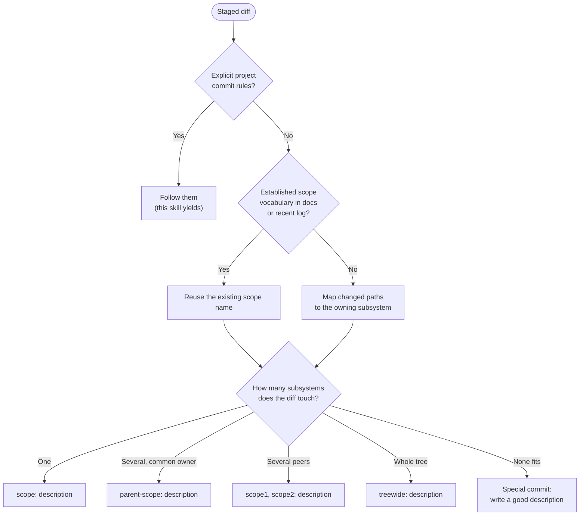
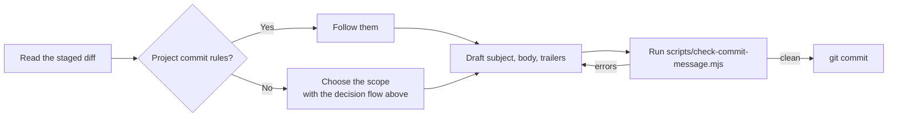

# Scoped Commits

Scoped Commits is a loose standard for commit messages
that puts the subject of the change first.
Normal commits are formatted as:

```text
<scope>: <description>

[optional body]

[optional trailer(s)]
```

This skill gives you the commit format,
the scope-selection rules,
the anti-patterns to suppress
(especially the Conventional Commits habit),
and a bundled validator.

## Philosophy

The _scope_ of a change
— the subsystem, area, or module it touches —
is the most important part of a commit message.
Every reader of the log is asking an area-shaped question:

| Reader             | Question in their head                             |
| ------------------ | -------------------------------------------------- |
| Contributor        | What happened in my area since I last contributed? |
| Debugger           | What touched the component where this bug lives?   |
| Incident responder | What changed around the time the outage started?   |

The _type_ of a change is a poor substitute:

- **It is redundant.**
  A good description already conveys it:
  `auth: prevent token refresh from racing expiry`
  is self-evidently a fix.
- **It is restrictive.**
  One commit can fix a bug, refactor the surrounding code,
  and add new behavior.
  No single label from `fix`, `feat`, or `refactor` fits,
  but the scope always fits.
- **It is optional in Conventional Commits**,
  which deprioritizes the one field readers actually need.

> [!IMPORTANT]
> Language models default to Conventional Commits
> far more often than not.
> Treat `fix: ...`, `feat(scope): ...`, and their cousins
> as a habit to actively suppress, not a neutral default.
> Where the repository does not prescribe another format,
> you MUST NOT begin a normal subject
> with a Conventional Commits type prefix.

## Project conventions come first

Repositories often add rules on top of Scoped Commits:
which scopes are valid,
how descriptions are capitalized,
which trailers are required.

Before composing a message,
you MUST follow the project's explicit commit guidance
(read `CONTRIBUTING.md`, `AGENTS.md`, commit templates,
commit-msg hooks,
and the established style in `git log --oneline -30`).

- When the repository prescribes a commit format
  (for example, commitlint enforcing Conventional Commits),
  you MUST follow the repository's format.
  When that format is Conventional Commits,
  you SHOULD fill the parenthesized field with a real project area,
  and you SHOULD NOT use a change-kind word there
  (`fix`, `feat`, `docs`),
  unless the repository's own rules say otherwise.
- When no format is prescribed,
  you MUST use the Scoped Commits format from this skill
  for normal commits.
  Special commits (merges, reverts, fixups, squashes, amends)
  are handled below.

For SHOULD and MAY rules, repository policy outranks this skill.
If repository policy conflicts with a MUST or a MUST NOT stated here,
you MUST halt, report the conflict, and ask which rule to follow.

## The format

```text
<scope>: <description>

[optional body]

[optional trailer(s)]
```

- `<scope>`:
  the subsystem, area, or module the commit touches.
- `<description>`:
  a short summary of what changed.
- `body`:
  detailed context the diff cannot express.
- `trailers`:
  `Token: value` metadata such as `Co-authored-by:` or `Jira-Ticket:`.

You MUST write the subject as a single line beginning
with `<scope>: <description>`.
A ticket reference MAY follow the scope parenthetically
(`auth (PROJ-123): fix login bug`)
or live in a trailer.

Scopes MAY be hierarchical
(for example, Linux writes `i2c: virtio: mark device ready before registering the adapter`
and Go writes `net/http/cookiejar: add godoc links`).
The scope MUST remain first;
any additional colons are part of the scope.

## Choosing the scope

You MUST reuse an existing scope name from the project's vocabulary
before inventing a new one.
You MUST NOT introduce a new scope
when an existing name in the documented vocabulary
or recent log clearly covers the changed area;
when unsure, you MUST halt and ask.



Natural scopes by project shape:

| Project shape                | Natural scope               | Example                     |
| ---------------------------- | --------------------------- | --------------------------- |
| Kernel or OS                 | subsystem                   | `i2c:`, `linuxulator:`      |
| Go module                    | package path                | `net/http/cookiejar:`       |
| Package collection (nixpkgs) | package or derivation       | `xwayland:`                 |
| Monorepo                     | package or service          | `billing:`, `web:`          |
| Single application           | feature area                | `auth:`, `parser:`          |
| CI and tooling               | tool or pipeline area       | `gitlab-ci:`                |
| Repository-wide change       | `treewide`, `all`, `global` | `treewide: drop Python 2`   |

You SHOULD derive the owning subsystem from the changed paths,
skipping generic directories such as `src/`, `lib/`, or `pkg/`,
unless the project documents its own scope-to-path mapping.
A scope names an area of the codebase that a maintainer would recognize,
not a file and not a line of code.

You MUST NOT use:

- a filename or path fragment (`login.ts:`, `src/auth:`),
- a ticket number (`PROJ-123:`, `#456:`),
- a change-kind word from the Conventional Commits type list
  (`build`, `chore`, `ci`, `docs`, `feat`, `fix`, `perf`,
  `refactor`, `revert`, `style`, `test`),
- a placeholder that names no specific project area
  (`misc`, `stuff`, `various`, `general`).

When in doubt between two scopes,
you SHOULD prefer the one already used in the log,
unless that scope would misrepresent the change
or the project documents a different preference.
Consistency makes the log greppable,
which is the entire point.

## Writing the description

The description completes the sentence
"This commit, in `<scope>`, ...".
A good description lets the subject alone
tell a contributor what changed.
You SHOULD keep the subject within 72 characters
unless the project defines a different length limit
or the description genuinely needs more detail.
Details that do not fit SHOULD go in the body
unless the project's length or style rules say otherwise.

- You SHOULD write the description in the imperative mood
  unless the project's established style uses another mood:
  `auth: prevent token refresh from racing expiry`
  reads as "apply this commit and it will ...".
- You MUST NOT use a description whose content is only the scope name.
  A description that merely paraphrases the scope
  (`auth: authenticate users`) adds nothing.
- You MAY name the change type inside the description:
  `auth: fix login redirect loop` is a scoped commit;
  `fix(auth): login redirect loop` is not.
- You SHOULD follow the project's capitalization style
  when it is established:
  Go uses lowercase descriptions
  (`net/http/cookiejar: add godoc links`),
  FreeBSD capitalizes them
  (`linuxulator: Return EINVAL for invalid inotify flags`).
  With no precedent, you SHOULD use lowercase and no trailing period,
  unless the project's tools (commit-msg hook, template, CI)
  or maintainers prescribe otherwise.

## Body, trailers, and tickets

The body SHOULD explain why the change was made,
unless the reason is evident from the subject or diff.
It is also the place for context a reviewer cannot see in the diff.

```text
auth: prevent token refresh from racing expiry

Refresh compared the stored expiry against wall-clock time,
so a clock adjustment could make a valid token look expired
and drop a live session. Compare against the server-issued
lifetime instead.

Fixes: #4821
Signed-off-by: Sam Example <sam@example.com>
```

- You MUST separate the subject from the body or trailers
  with one blank line.
- You SHOULD wrap body lines at 72 characters
  unless the project says otherwise;
  long unbroken lines are painful in `git log`.
- You MUST use `Token: value` trailer syntax
  so `git interpret-trailers`, GitHub, and GitLab can parse it.
- If a ticket reference is present,
  you MUST place it after the scope (parenthetically)
  or in a trailer;
  you MUST NOT let it replace the scope.

  ```text
  auth (PROJ-123): fix login bug

  This commit fixes the login bug by ...
  ```

  ```text
  auth: fix login bug

  This commit fixes the login bug by ...

  Jira-Ticket: PROJ-123
  ```

  The parenthetical form keeps the scope scannable;
  the trailer form keeps the ticket greppable.
  Either is correct; `PROJ-123: fix login bug` is not.

## Multiple scopes

When one commit touches several areas,
the subject MUST still lead with a scope.
You MUST choose the earliest applicable option from this list:

1. A general scope that covers all of them
   (`parser: handle ...`).
2. Comma-separated peer scopes
   (`api, worker: stop retrying permanently failed jobs`).
3. `treewide`, `all`, or `global`
   when the whole tree is touched.
4. A special commit with a good description
   when no scope applies at all.

If applying the earliest option would misrepresent the change,
you MUST halt and ask rather than guessing.
You MUST NOT present a scope that names only part of the touched areas
as covering the whole diff.
A scope that lies corrupts the index for everyone.

## Special commits

Merges, reverts, fixups, squashes, and amends
are outside the normal format.
You MAY use Git's default forms for them.
Projects MAY define their own rules for them.

- `fixup!` and `squash!` subjects target another commit,
  so you MUST copy that subject:
  `fixup! auth: prevent token refresh from racing expiry`.
- By default, keep the original revert subject:
  `Revert "auth: prevent token refresh from racing expiry"`,
  and you SHOULD put the reason in the body
  unless the diff itself makes it clear.
- When the project's style prefers it,
  you MAY use a scoped revert subject:
  `auth: revert token refresh race fix`.
- You MUST NOT rewrite a merge's subject
  into the `<scope>: <description>` form.
- Release commits are special too.
  You SHOULD cut the release with a tag rather than a commit,
  unless the process must commit a version first
  (for example, a `VERSION` file that is tagged afterwards).
  When a commit is required,
  you SHOULD write the version change as `<scope>: <old> -> <new>`
  (`release: 2.3.0 -> 2.4.0`, `my/pkg: 1.4.2 -> 1.4.3`,
  `treewide: 24.1.11 -> 24.1.12`),
  so the bump is visible at a glance and release commits are greppable.
  For a first release, `<old>` is the zero version of the project's scheme
  (`0.0.0 -> 1.0.0`, `0 -> 1`, `0000.0 -> 2026.6`),
  unless the project's release tooling prescribes another subject.
  Event subjects such as `Release 2.4.0`
  are project-defined specials for the project's own hook;
  the bundled checker accepts the scoped forms above.

## Anti-patterns

| Anti-pattern                            | Why it fails                                               | Write instead                                       |
| --------------------------------------- | ---------------------------------------------------------- | --------------------------------------------------- |
| `fix(auth): prevent token race`         | Type first; scope demoted to a parenthetical               | `auth: prevent token refresh from racing expiry`    |
| `feat: add proration preview`           | No scope at all                                            | `billing: add proration preview endpoint`           |
| `chore: bump dependencies`              | Names a change kind, says nothing about the area           | `deps: bump axios to 1.2.3`                         |
| `PROJ-123: fix login`                   | Ticket replaced the scope                                  | `auth (PROJ-123): fix login bug`                    |
| `src/auth/login.ts: handle empty pw`    | File name is not a subsystem                               | `auth: handle empty password in login`              |
| `misc: clean up`                        | Scope identifies nothing                                   | Name the area, or use `treewide`                    |
| `refactor(core): Update webmcp support` | Fix and feat forced into one label                         | `core/webmcp: support document.modelContext`        |

## Changelogs and automation

A commit log is not a changelog:

- The **commit log** is developer-facing
  and tells the story of how the codebase changed, scope by scope.
- The **changelog** is user-facing
  and describes functional differences between releases.

You MUST NOT generate a user-facing changelog
by dumping or parsing the commit log, scoped or otherwise.
Multiple commits land one feature,
reverts cancel earlier changes,
and users do not care how the code got there.
You SHOULD maintain a curated changelog instead
(see [Keep a Changelog](https://keepachangelog.com/)),
unless the project does not publish one.

Likewise, you MUST NOT drive build, publish, or security automation
from commit subjects or types.
A commit titled `docs: fix typos` can touch the authentication subsystem,
and subject-based automation would skip its security checks.
You MUST select work from changed paths instead:

```sh
git diff --cached --name-only
```

Scope guides humans;
changed paths drive automation.

## Reviewing commits

When reviewing a commit, a commit message, or a PR title:

You MUST NOT flag a commit that complies with the repository's
prescribed format (see "Project conventions come first").

1. You MUST check that the subject leads with a scope
   from the project's vocabulary,
   not a filename, ticket, change kind, or placeholder
   (see "Choosing the scope").
2. You MUST flag Conventional Commits prefixes
   and ask for the scope-first rewrite.
3. You MUST flag ticket numbers, filenames,
   and change kinds used as scopes.
4. You MUST check the blank line after the subject
   and the trailer syntax.
5. You SHOULD suggest moving type words out of the prefix
   and into the description,
   unless the project's own format requires the type prefix.

## Workflow



## Validation

This skill bundles `scripts/check-commit-message.mjs`
(relative to this skill directory).
You SHOULD run it before writing or approving a commit,
unless the commit is a special commit.

```sh
scripts/check-commit-message.mjs path/to/COMMIT_EDITMSG

# or explicitly through Node
node scripts/check-commit-message.mjs path/to/COMMIT_EDITMSG

# or from standard input
printf '%s' 'auth: prevent token refresh from racing expiry' \
  | scripts/check-commit-message.mjs -
```

The checker validates the format,
detects Conventional Commits prefixes,
flags ticket-like scopes and missing blank lines,
and warns about overlong subjects.
Exit status 0 means the message is valid;
1 means it violates the format;
warnings alone never fail.

To enforce the format mechanically,
you MAY call the checker from a `commit-msg` hook
(Git passes the message file path as the hook argument):

```sh
"<skill-dir>/scripts/check-commit-message.mjs" "$1"
```

Call the checker from the hook rather than symlinking it as the hook itself,
so the hook can run other checks alongside it;
`--help` prints this command with the script's location resolved.

The checker only enforces portable Scoped Commits rules.
You SHOULD put project-specific rules
(valid scope vocabulary, description casing)
in the project's own docs and tooling,
unless the project already records them elsewhere.

## Examples

Real projects using the style:

| Project | Format                   | Example                                                         |
| ------- | ------------------------ | --------------------------------------------------------------- |
| Linux   | `subsystem: description` | `i2c: virtio: mark device ready before registering the adapter` |
| FreeBSD | `prefix: Description`    | `linuxulator: Return EINVAL for invalid inotify flags`          |
| Git     | `area: description`      | `gitlab-ci: update macOS image`                                 |
| Go      | `package: description`   | `net/http/cookiejar: add godoc links`                           |
| nixpkgs | `pkg-name: description`  | `xwayland: 24.1.11 -> 24.1.12`                                  |
| Node.js | `subsystem: description` | `stream: fast-path stateless transform flush results`           |

Rewrite practice:

| Conventional Commits                         | Scoped Commits                                                         |
| -------------------------------------------- | ---------------------------------------------------------------------- |
| `fix(compiler): prevent namespaced SVG ...`  | `compiler: prevent namespaced SVG <style> elements from being stripped` |
| `refactor(core): Update webmcp support`      | `core/webmcp: support document.modelContext`                           |
| `docs: fix auth typos`                       | `auth: fix typos in token refresh comments`                            |
| `chore: release 2.4.0`                       | `release: 2.3.0 -> 2.4.0`                                              |

## Normative requirements

```mermaid
requirementDiagram

    requirement scoped_subject {
        id: R1
        text: "Write normal commit subjects with scope before description"
        risk: High
        verifymethod: Test
    }

    requirement no_type_prefix {
        id: R2
        text: "Do not prefix subjects with a Conventional Commits type"
        risk: High
        verifymethod: Test
    }

    requirement area_scope {
        id: R3
        text: "Name a project area as scope, never a change kind, file, or ticket"
        risk: High
        verifymethod: Inspection
    }

    requirement project_precedence {
        id: R4
        text: "Apply repository rules over SHOULD and MAY rules and halt for MUST conflicts"
        risk: High
        verifymethod: Inspection
    }

    requirement blank_line {
        id: R5
        text: "Separate the subject from body and trailers with one blank line"
        risk: Medium
        verifymethod: Test
    }

    requirement reuse_vocabulary {
        id: R6
        text: "Reuse existing project scope vocabulary before inventing names"
        risk: Medium
        verifymethod: Inspection
    }

    requirement multi_scope {
        id: R7
        text: "Use the earliest applicable option among general scope, scope list, treewide, and special commit"
        risk: Medium
        verifymethod: Inspection
    }

    requirement ticket_placement {
        id: R8
        text: "Place ticket references after the scope or in trailers, never as the scope"
        risk: Medium
        verifymethod: Test
    }

    requirement no_log_changelog {
        id: R9
        text: "Do not generate user-facing changelogs from the commit log"
        risk: High
        verifymethod: Inspection
    }

    requirement diff_based_automation {
        id: R10
        text: "Select automation work from changed paths, not commit subjects or types"
        risk: High
        verifymethod: Inspection
    }

    requirement revert_handling {
        id: R11
        text: "Keep original merge and revert subjects by default and allow scoped reverts only as a project style"
        risk: Medium
        verifymethod: Inspection
    }

    element commit_message {
        type: artifact
        docRef: "Git commit message"
    }

    element project_policy {
        type: artifact
        docRef: "CONTRIBUTING.md, AGENTS.md or repo hooks"
    }

    commit_message - satisfies -> scoped_subject
    commit_message - satisfies -> no_type_prefix
    commit_message - satisfies -> area_scope
    commit_message - satisfies -> blank_line
    commit_message - satisfies -> reuse_vocabulary
    commit_message - satisfies -> multi_scope
    commit_message - satisfies -> ticket_placement
    commit_message - satisfies -> revert_handling
    project_policy - satisfies -> project_precedence
    project_policy - satisfies -> no_log_changelog
    project_policy - satisfies -> diff_based_automation
```



The bundled checker verifies R1, R2, R5, and R8,
and warns about subject length.
R3, R4, R6, R7, R9, R10, and R11 are review obligations.

## Sources

- [Scoped Commits](https://scopedcommits.com) — the standard.
- [Stop Using Conventional Commits](https://sumnerevans.com/posts/software-engineering/stop-using-conventional-commits/)
  — Sumner Evans on why scope beats type.
- [Conventional Commits, considered harmful](https://richvdh.org/conventional-commits-considered-harmful.html)
  — richvdh.org.
- [Keep a Changelog](https://keepachangelog.com/) and
  [Common Changelog](https://common-changelog.org/)
  — for the changelog side of the split.
