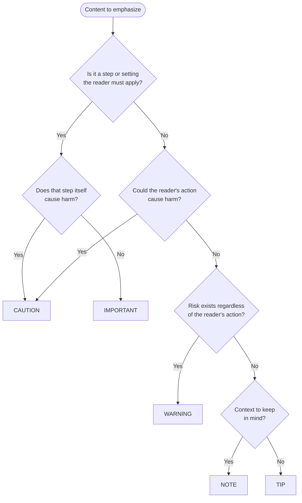

# GitHub-Flavored Markdown alerts

Alerts are a GitHub extension of Markdown
used to emphasize critical information.
On GitHub,
they render with distinctive colors and icons
indicating the importance of the content.

> [!NOTE]
>
> This syntax is GitHub-specific.
> Other platforms may render alerts as plain blockquotes.

## Quick reference

| Type           | Purpose                                 | Severity |
| -------------- | --------------------------------------- | -------- |
| `[!TIP]`       | Optional advice                         | Lowest   |
| `[!NOTE]`      | Context to keep in mind                 | Low      |
| `[!IMPORTANT]` | Required action or setting              | Medium   |
| `[!WARNING]`   | External risk regardless of user action | High     |
| `[!CAUTION]`   | User action may cause harm              | Highest  |

## Syntax

Alerts use blockquote syntax with a special type marker:

```markdown
> [!TYPE]
>
> Content goes here.
```

> [!IMPORTANT]
>
> The type marker MUST be:
>
> - On its own line immediately after `>`
> - One of the five valid types:
>   `TIP`, `NOTE`, `IMPORTANT`, `WARNING`, `CAUTION`

The marker is case-insensitive on GitHub:
`[!note]` and `[!NOTE]` render identically.
Uppercase is the conventional spelling in GitHub's documentation.

## The five alert types

Each alert type has a respective semantic weight.
Take this into account
when reading skill files, agent definitions, or documentation.

### `TIP`

Optional information to help a user be more successful.
Apply when applicable;
safe to skip if context differs.

```markdown
> [!TIP]
>
> Run with `--verbose` to see detailed progress output.
```

**Use for:**

- Productivity hints
- Alternative approaches
- Best practices
- Shortcuts and conveniences

### `NOTE`

Highlights information users should take into account,
even when skimming.
Useful context but not directly actionable.

```markdown
> [!NOTE]
>
> Results are cached for 24 hours.
```

**Use for:**

- Supplementary context
- Prerequisite context (version and dependency requirements)
- "Good to know" information

### `IMPORTANT`

Crucial information necessary for users to succeed.
Treat the content as must-know.
When the alert carries no explicit RFC 2119 keyword,
treat any directive inside it as a hard requirement.

```markdown
> [!IMPORTANT]
>
> Back up your database before running this migration.
```

**Use for:**

- Required steps that might be overlooked
- Configuration that the reader must set correctly
- Actions that the task fails without

### `WARNING`

A risk exists independently of the user's action.
The danger comes from external factors
— a deprecated API, a known bug, a security vulnerability.
Factor the external risk into your approach;
proceed with awareness.

```markdown
> [!WARNING]
>
> This API endpoint is deprecated
> and may be removed without notice in a future release.
```

**Use for:**

- Security implications
- Performance impacts
- Breaking changes

### `CAUTION`

The user's action may cause negative consequences.
The danger comes from what the user is about to do.
Verify the action is necessary and safe in your context before proceeding.

```markdown
> [!CAUTION]
>
> Running this in production may cause service interruption.
```

**Use for:**

- Irreversible operations
- Side effects of an action
- Potential gotchas
- Edge cases that cause problems
- "Proceed with care" situations

## Choosing the right type

Follow the decision path:



Common ambiguities:

- You MUST NOT label an action-caused risk `WARNING`;
  `WARNING` is for danger that exists even when the reader does nothing.
- A required step that is itself harmful is `CAUTION`;
  the harmful consequence is the stronger signal.
- `NOTE` is for information the reader needs while working;
  `TIP` is for advice the task can succeed without.
- When the content carries an explicit RFC 2119 keyword,
  choose the alert by the consequence, not the keyword
  (see "With RFC 2119 keywords").

## Formatting guidelines

### Multi-line content

Continue content on subsequent lines with `>`:

```markdown
> [!WARNING]
>
> This operation is destructive.
>
> Ensure you have a backup before proceeding.
> Recovery is not possible after completion.
```

### With other Markdown

Alerts support standard Markdown inside:

```markdown
> [!TIP]
>
> Use `grep -r "pattern"` to search recursively.
>
> For more options,
> see the
> [grep manual](https://man7.org/linux/man-pages/man1/grep.1.html).
```

Lists render inside alerts:

```markdown
> [!IMPORTANT]
>
> Before deploying:
>
> - Run the migration script
> - Update environment variables
> - Notify the on-call team
```

### Placement

- You SHOULD place alerts near the content they relate to.
  Placement at section boundaries is acceptable
  when an alert applies to multiple paragraphs.
- You SHOULD put warnings and cautions before the dangerous action.
  Placement after is acceptable
  when the danger only applies to specific variations.
- You SHOULD put notes and tips after introducing the concept.
  Leading placement is acceptable for prerequisites.

### Length and frequency

If everything is important, nothing is.
Use alerts sparingly to preserve their impact.

- You SHOULD keep alerts concise
  — long alerts lose impact.
  Longer alerts are acceptable
  when multiple related points must be grouped.
- You SHOULD use one alert per concept;
  avoid stacking multiple alerts.
  Stacking is acceptable
  when alerts are at different severity levels for the same topic.

## Common mistakes

The following mistakes break alert rendering.

```markdown
<!-- WRONG — type marker not on its own line -->

> [!NOTE] This won't render correctly.

<!-- CORRECT -->

> [!NOTE]
>
> This renders correctly.
```

```markdown
<!-- WRONG — nested alerts don't render -->

> [!NOTE]
>
>> [!WARNING]
>> This inner alert will not render.

<!-- CORRECT — use a single alert -->

> [!WARNING]
>
> This renders correctly as a warning.
```

> [!CAUTION]
>
> You MUST NOT place content on the same line as the type marker.
> You MUST NOT nest alerts inside other alerts
> — GitHub renders the inner alert marker as plain text.

You SHOULD NOT create alerts with no content body.
An empty alert is worse than useless:
it adds visual noise without information.

## With RFC 2119 keywords

You MUST preserve RFC 2119 keywords when converting content to alerts.
Alerts convey visual emphasis;
keywords convey obligation strength.
They are complementary, not interchangeable.
Alerts MUST NOT drop or downgrade an RFC 2119 keyword.

```markdown
<!-- WRONG — keyword dropped -->

> [!TIP]
>
> Choose keywords based on behavior under pressure.

<!-- CORRECT — keyword preserved -->

> [!TIP]
>
> You SHOULD choose keywords based on behavior under pressure.
```

> [!CAUTION]
>
> Dropping an RFC 2119 keyword when converting prose to an alert
> permanently changes the obligation level.
> A "SHOULD" that becomes unmarked prose
> reads as a suggestion instead of a justified-deviation rule.

When an alert contains explicit RFC 2119 keywords,
those keywords define the obligation
— the alert type provides visual emphasis,
not an obligation override.

When an alert contains no RFC 2119 keywords,
use the alert type as the default interpretation,
as described in each type's section above.
