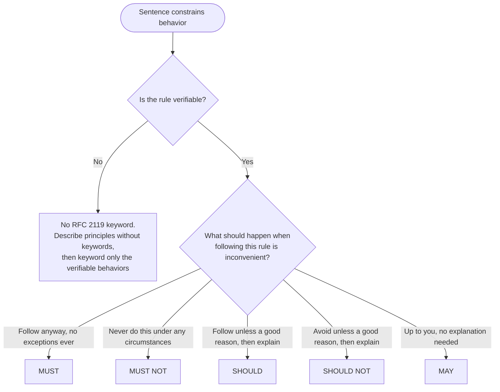
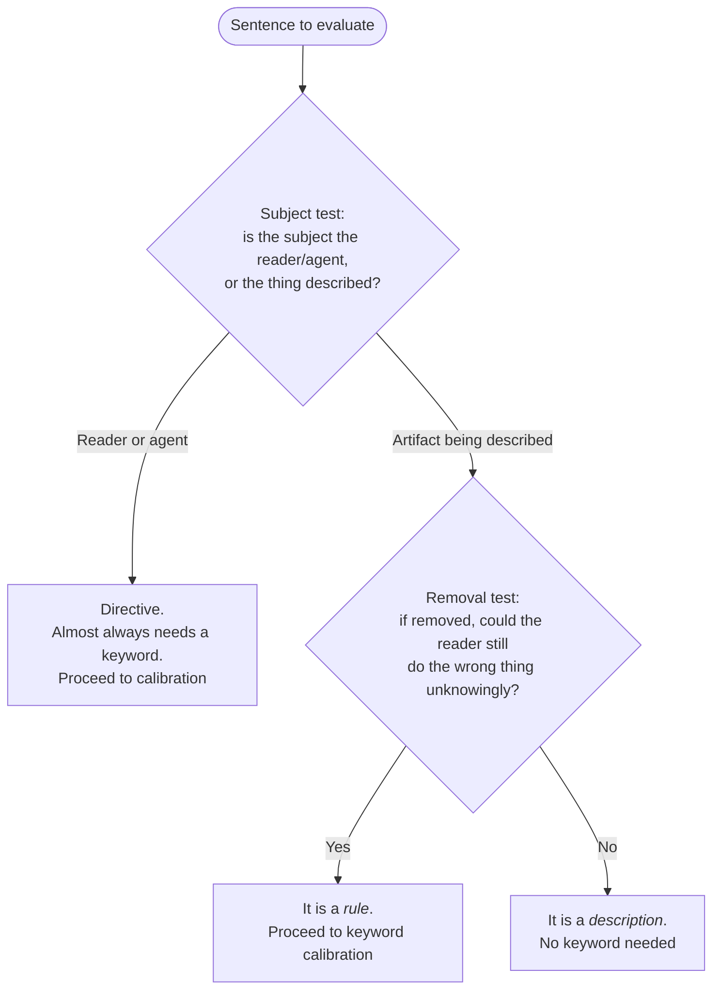
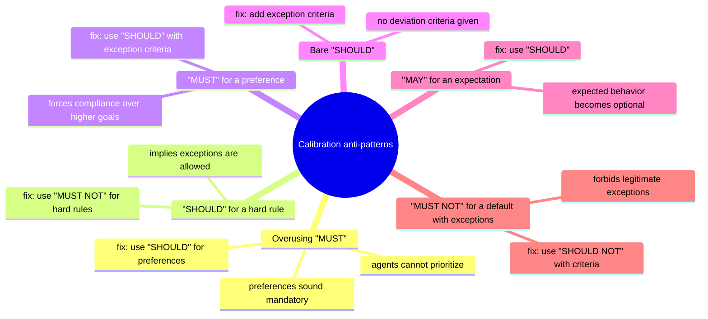
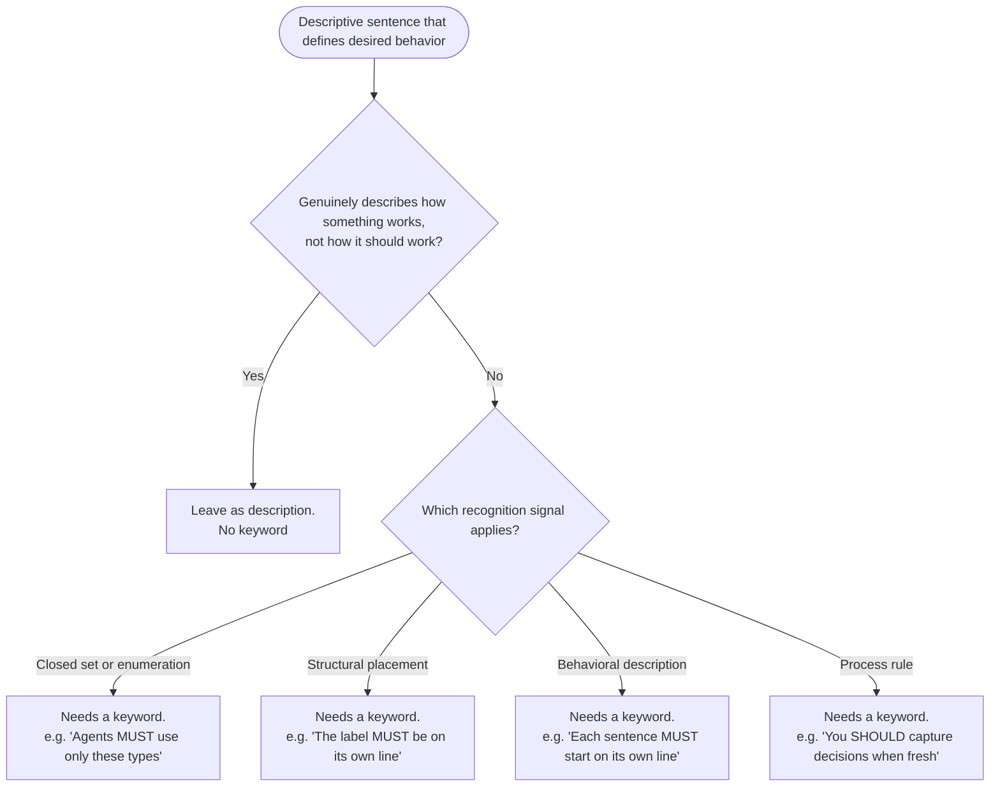
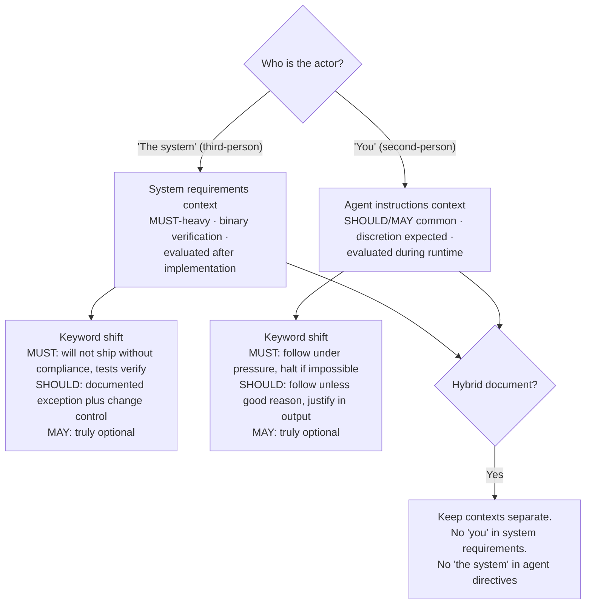
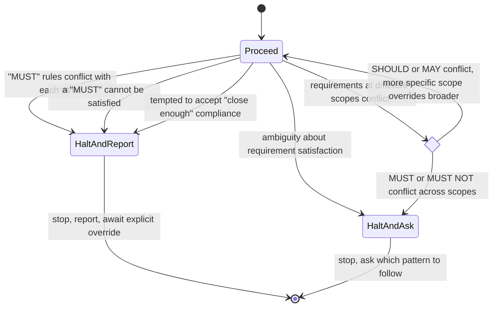

# RFC 2119 for agents

## Philosophy

Obligation keywords are the precision tool
for constraining behavior in prose.
Miscalibrated keywords cause two failure modes:
over-calibration drowns critical rules in noise
(when everything is "MUST", agents cannot prioritize);
under-calibration leaves rules unenforceable
(descriptive voice states facts but does not constrain).

This skill provides the calibration framework;
it owns the obligation layer
that applies across all prose artifacts.

## Keyword Table



| Keyword                          | Interpretation                             |
| -------------------------------- | ------------------------------------------ |
| "MUST" / "REQUIRED" / "SHALL"    | Follow always, no exceptions               |
| "MUST NOT" / "SHALL NOT"         | Never do this, no exceptions               |
| "SHOULD" / "RECOMMENDED"         | Follow unless justified, explain deviation |
| "SHOULD NOT" / "NOT RECOMMENDED" | Avoid unless justified, explain if done    |
| "MAY" / "OPTIONAL"               | Use own judgment, no explanation needed    |

> [!TIP]
>
> "MAY" is genuinely optional
> — no explanation needed either way.
> "You MAY add inline comments for complex logic"
> means the agent decides without justification.
> If you would be disappointed when the agent skips it,
> the rule is "SHOULD", not "MAY".

## Verifiability requirement

You MUST only use RFC 2119 keywords for verifiable rules.
A rule is verifiable
if compliance can be objectively determined.

> [!CAUTION]
>
> Unverifiable rules with "MUST" create impossible situations.
> The agent cannot confirm compliance,
> so it ignores the rule, freezes, or rationalizes.

For judgment-based guidance,
you MUST NOT put keywords on the judgment itself,
and you MUST reserve keywords
for the verifiable behaviors that apply that guidance.

## Sentence intent test



Before calibrating a keyword,
determine whether the sentence expresses a rule;
the flowchart above encodes the removal test and the subject test.

Examples:
- "You wrap errors with context" is a rule stated as a habit;
  "You MUST wrap errors with context" is the same rule.
- "The label goes on its own line" is a rule
  disguised as a description of label behavior.
- "Labels have two patterns: run-in headings and lead-ins"
  is a factual description, not a rule.

> [!NOTE]
>
> Descriptive voice is the default failure mode
> when authoring instructions.
> Agents produce "the vocabulary is closed to these types"
> when they mean "agents MUST use only these types".
> Facts do not constrain behavior
> — obligations do.

You MUST NOT add keywords to factual descriptions,
definitions, or examples.
If a sentence describes a typical workflow
without constraining it,
you MUST leave it as a description.

## Anti-patterns



> [!CAUTION]
>
> When everything is "MUST",
> critical rules stop standing out.

- **Overusing "MUST":**
  ask "would I accept a deviation?";
  if yes, use "SHOULD"
  (e.g. semicolons).
- **"SHOULD" for a hard rule:**
  "SHOULD NOT commit secrets" implies an allowed exception;
  say "MUST NOT".
- **"MUST" for a preference:**
  an 80-char line "MUST" makes agents break URLs;
  use "SHOULD" with criteria.
- **Bare "SHOULD":**
  with no criteria,
  the agent cannot tell when skipping is justified;
  add them
  ("unless trivial config change").
- **"MAY" for an expectation:**
  marking expected work optional invites skips;
  use "SHOULD".
- **"MUST NOT" for a default with exceptions:**
  "MUST NOT use inline styles" blocks valid dynamic emails;
  use "SHOULD NOT" with criteria.

## Descriptive-to-prescriptive transformations



When writing rules or constraints,
you MUST use prescriptive voice.
The specific keyword ("MUST", "SHOULD", "MAY")
depends on the decision test above.

| Descriptive (avoidable)                                  | Prescriptive                                       | Signal                   |
| -------------------------------------------------------- | -------------------------------------------------- | ------------------------ |
| "The vocabulary is closed to these types"                | "Agents MUST use only these types"                 | Closed set / enumeration |
| "Label goes on its own line"                             | "The label MUST be on its own line"                | Structural placement     |
| "Each sentence starts on its own line"                   | "Each sentence MUST start on its own line"         | Behavioral description   |
| "Short clauses remain on one line"                       | "Short clauses MAY remain on one line"             | Behavioral description   |
| "Lightweight capture happens when the decision is fresh" | "You SHOULD capture decisions when they are fresh" | Process / workflow       |

**Recognition signals:**

- **Closed sets and enumerations:**
  if the reader cannot add to the set,
  the constraint needs a keyword.
- Structural placement:
  if putting content elsewhere would be wrong,
  the placement needs a keyword.
- **Behavioral descriptions:**
  if the subject "does" something
  as if describing an existing behavior
  but the sentence defines the desired behavior,
  the sentence needs a keyword.
- **Process rules:**
  if the timing or sequence matters,
  the step needs a keyword.

You MUST NOT transform sentences
that genuinely describe how something works
rather than how it should work.

## Actor contexts



RFC 2119 keywords work in two distinct contexts:

| Context             | Actor        | Typical balance                            |
| ------------------- | ------------ | ------------------------------------------ |
| System requirements | "the system" | "MUST"-heavy, binary verification          |
| Agent instructions  | "you"        | "SHOULD"/"MAY" common, discretion expected |

**System requirements context:**

| Aspect                | Description                           |
| --------------------- | ------------------------------------- |
| **Actor**             | "The system" (third-person)           |
| **Verification**      | Binary — automated tests, QA sign-off |
| **Keyword balance**   | "MUST"-heavy (hard specs, contracts)  |
| **Audience**          | Developers who build the system       |
| **Evaluation timing** | After implementation                  |

**Agent instructions context:**

| Aspect                | Description                                                 |
| --------------------- | ----------------------------------------------------------- |
| **Actor**             | "You" (second-person)                                       |
| **Verification**      | Observed judgment — behavior monitoring, discretion allowed |
| **Keyword balance**   | "SHOULD"/"MAY" common (agents reason about exceptions)      |
| **Audience**          | The agent itself                                            |
| **Evaluation timing** | During runtime                                              |

This skill is itself an agent instruction and is intentionally MUST-heavy,
because it defines the obligation layer rather than a workflow.

**Hybrid documents:**
some documents mix both contexts
— a skill might include agent instructions
and system requirements for code the agent writes.
You MUST keep contexts separate within the document.
You MUST NOT write "you" in a system requirement
or "the system" in an agent directive.

**Worked examples:**
the same need looks different in each context:

```markdown
<!-- Error logging — system requirement -->

If an unhandled exception occurs,
then the system MUST log the error with full stack trace.

<!-- Error logging — agent instruction -->

You MUST report unexpected errors with relevant context
before attempting recovery.
```

```markdown
<!-- Input validation — system requirement -->

When the user submits a form,
the system MUST validate all required fields before processing.

<!-- Input validation — agent instruction -->

You SHOULD validate user input against known constraints
before proceeding,
unless doing so would block reasonable user intent.
```

Note the shift from "MUST" to "SHOULD" in input validation
— agents encounter edge cases
where strict validation blocks reasonable user intent.

## Capitalization

RFC 2119 keywords only have formal meaning in uppercase.
Uppercase is reserved for RFC 2119 keywords
and the documented exemptions.
Other vocabulary MUST NOT use uppercase.

Acronyms (`CI`, `OS`),
code identifiers (`EINVAL`),
ticket identifiers (`PROJ-123`),
filenames (`CONTRIBUTING.md`),
and GFM alert markers (`[!IMPORTANT]`)
keep their conventional capitalization.
They are not keyword vocabulary.

## Conflict resolution



When "MUST" rules conflict with each other,
agents MUST stop and report the conflict.
Agents MUST NOT choose which rule to violate.

When a "MUST" cannot be satisfied at all,
agents MUST halt and report impossibility.
Agents MUST NOT proceed without explicit override.
Incomplete compliance is not compliance.

> [!IMPORTANT]
>
> Agents MUST NOT rationalize "close enough" compliance.
> Agents MUST halt and report that the requirement cannot be met.

Agents MUST NOT proceed under ambiguity
about requirement satisfaction.
When multiple conflicting patterns exist,
you MUST halt and ask which pattern to follow.

**Scope conflicts:**
when requirements at different scopes conflict
(global vs. project vs. task),
the more specific scope MUST override the broader one
for "SHOULD" and "MAY" rules.
For "MUST" and "MUST NOT" conflicts across scopes,
you MUST treat them as unclear and halt to ask
— you MUST NOT assume override.

## Normative requirements

The skill's own "MUST" obligations, encoded so they can be checked by inspection:

```mermaid
requirementDiagram

    requirement verifiable_only {
        id: R1
        text: Use RFC 2119 keywords only for verifiable rules
        risk: High
        verifymethod: Inspection
    }

    requirement no_keywords_on_descriptions {
        id: R2
        text: Do not add keywords to factual descriptions definitions or examples
        risk: High
        verifymethod: Inspection
    }

    requirement prescriptive_voice {
        id: R3
        text: Use prescriptive voice
        risk: High
        verifymethod: Inspection
    }

    requirement separate_contexts {
        id: R4
        text: Keep system requirement and agent instruction contexts separate in hybrid documents
        risk: Medium
        verifymethod: Inspection
    }

    requirement caps_reserved {
        id: R5
        text: Reserve uppercase for RFC 2119 keywords and the documented exemptions
        risk: Medium
        verifymethod: Inspection
    }

    requirement halt_on_conflict {
        id: R6
        text: Stop and report when MUST rules conflict instead of choosing which to violate
        risk: High
        verifymethod: Inspection
    }

    requirement halt_on_impossible {
        id: R7
        text: Halt and report when a MUST cannot be satisfied instead of proceeding without override
        risk: High
        verifymethod: Inspection
    }

    requirement no_ambiguity {
        id: R8
        text: Do not proceed under ambiguity about requirement satisfaction
        risk: High
        verifymethod: Inspection
    }

    requirement no_close_enough {
        id: R9
        text: Do not rationalize close enough compliance
        risk: High
        verifymethod: Inspection
    }

    element agent_prompt {
        type: artifact
        docRef: prose being authored or reviewed
    }

    element skill {
        type: artifact
        docRef: this skill
    }

    agent_prompt - satisfies -> verifiable_only
    agent_prompt - satisfies -> no_keywords_on_descriptions
    agent_prompt - satisfies -> prescriptive_voice
    agent_prompt - satisfies -> halt_on_conflict
    agent_prompt - satisfies -> no_ambiguity
    agent_prompt - satisfies -> no_close_enough
    agent_prompt - satisfies -> halt_on_impossible
    skill - satisfies -> separate_contexts
    skill - satisfies -> caps_reserved
```


